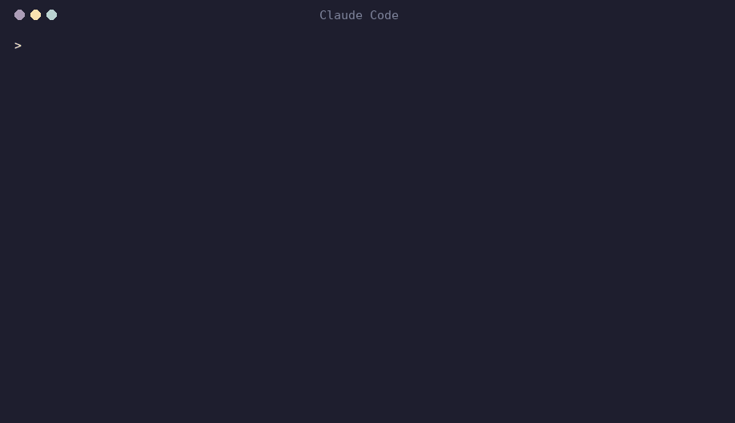
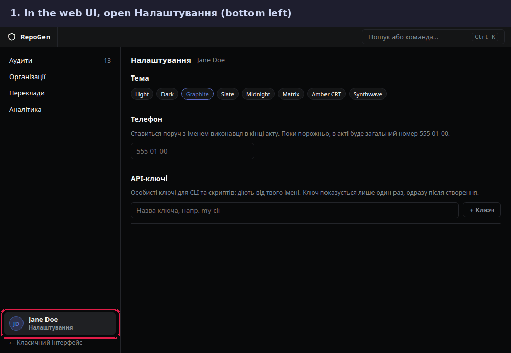

# reportgen

A [Claude Code] plugin for Report Generator. It bundles the `reportgen`
CLI with the skills and workflows that drive it, so you can ask Claude
about your audits in plain language and have it query, triage and edit
them through the API.



*Rendered from a real Claude Code session with this plugin, run against a
demo backend with fictional data. Long commands are cut with an ellipsis.*

[Claude Code]: https://claude.com/claude-code

## Install

You need [uv] on your `PATH` (the CLI runs through it; Python and the
packages are fetched automatically on first use) and `bash`. `jq` is
recommended, since Claude uses it to filter the CLI's JSON output.

In Claude Code:

```
/plugin marketplace add Rundi0/reportgen-plugin
/plugin install reportgen@reportgen
```

The install dialog asks for three settings:

| Setting | What to enter |
| --- | --- |
| Report Generator URL | Base URL of your instance. Defaults to `https://report.lan`. |
| API key | A personal key from the web UI, see [Get an API key](#get-an-api-key). |
| Verify TLS certificate | Leave on unless your instance uses a self-signed certificate. Always off for `https://report.lan`. |

Start a new session and try it: *"list my audits"*.

To change a setting later run `/plugin configure reportgen@reportgen`;
the new value applies from the next session. To install from a shell
instead, pass the values as flags:
`claude plugin install reportgen@reportgen --config api_key=...`.

To update, run `/plugin marketplace update reportgen`.

## Get an API key



1. In the Report Generator web UI, open **Налаштування** (Settings): your name at the bottom of the left sidebar.
2. Under **API-ключі**, type a name for the key (for example `claude-code`) and press **+ Ключ**.
3. Press **Копіювати** straight away: the key starts with `rg_` and is shown only once.
4. Paste it into the **API key** field of the install dialog. If the plugin is already installed, run `/plugin configure reportgen@reportgen` instead.

The key acts as you, with your permissions. To revoke it, press **Відкликати** next to it on the same page.

*Screenshots are from a development instance; the key shown has been deleted.*

## What you get

**The `reportgen` command**, available to Claude as a bare command. It
mirrors the REST API one-to-one and prints JSON. The full reference is
below.

**Skills**, which Claude loads by itself when a request matches:

| Skill | Use it for |
| --- | --- |
| `reportgen-cli` | Any question or change about organizations, audits, hosts, services, vulnerabilities, scan tasks or reports. |
| `verify-vuln` | Triaging one vulnerability: check each `new` instance with a single benign request, mark it approved or false positive, write the proofs. |

**Workflows**, which fan the work out over several agents:

| Workflow | What it does |
| --- | --- |
| `/reportgen:verify-audit-vulns` | Runs `verify-vuln` on every vulnerability in an audit that still has `new` instances, one agent per vulnerability. |
| `/reportgen:manual-vuln-hunt` | Looks for vulnerabilities scanners miss: assesses each service, probes the promising areas, independently verifies every hypothesis, and writes the confirmed findings to `manual-hunt-results-<audit>.json`. |

Both take the audit ID, for example *"verify all vulnerabilities in
audit 17"*. Workflows need a paid Claude plan or API access, and they
send real requests to the audited hosts, so run them only against
targets you are authorized to test.

## Things to ask

- "Which audits are in progress, and what is left to triage in the ACME one?"
- "Show the critical vulnerabilities in audit 17 and the services they affect."
- "Verify vulnerability 412 in audit 17."
- "Upload this Nessus scan into audit 17."
- "Generate the scan act for audit 17." (Claude first checks that every vulnerability has a translation and tells you if some do not.)

Claude asks before anything that changes data unless your request
already says to do it.

## Where the API key lives

Claude Code keeps the key in its secure storage, but it passes plugin
settings only to hooks, not to the commands Claude runs. So at session
start the plugin copies the URL and key to `~/.config/reportgen/.env`
(mode 600), and `reportgen` reads them from there. The key is therefore
stored in that file in plain text. The same file works if you use the
CLI outside Claude Code; you can write it by hand.

# CLI reference

## Install / run without the plugin

The recommended way is the bundled wrapper script — no manual venv,
no `PYTHONPATH`, runs from any directory. It uses [uv] to build and
cache a venv next to the package on first call (`cli/.venv`):

```bash
./cli/reportgen --help
./cli/reportgen services list 9
```

You can symlink it onto `$PATH` so it's just `reportgen` from
anywhere:

```bash
ln -s "$PWD/cli/reportgen" ~/.local/bin/reportgen
reportgen audits list
```

Other ways to run:

```bash
# uv directly (no wrapper)
uv run --project ./cli reportgen <cmd>

# install as a uv tool (puts `reportgen` on $PATH globally)
uv tool install ./cli

# classic pip into an existing venv
pip install -e ./cli && reportgen <cmd>

# without installing at all
PYTHONPATH=./cli python -m reportgen_cli <cmd>
```

[uv]: https://docs.astral.sh/uv/

## Connection

The CLI talks to the backend over HTTP, authenticating with the
session cookie produced by Keycloak login (`/api/auth/login`). Pass
the URL and the session id via shell env, a `.env` file, or flags:

```bash
# direct shell export
export REPORTGEN_URL="https://reports.example.com"
export REPORTGEN_SESSION_ID="<value of the session_id cookie>"
```

```dotenv
# .env in the current directory (or any parent) — auto-loaded
REPORTGEN_URL=https://reports.example.com
REPORTGEN_SESSION_ID=<value of the session_id cookie>
```

An API key works the same way and does not expire: `--api-key` or
`REPORTGEN_API_KEY`.

Resolution order (first wins): `--url` / `--api-key` / `--session-id`
flag, then existing shell env var, then a `.env` file. The
`cli/reportgen` wrapper auto-points at `cli/.env` if it exists, else at
`~/.config/reportgen/.env`; otherwise the CLI walks up from the current
working directory looking for `.env`.
Override either with `--env-file PATH` or `REPORTGEN_ENV_FILE=PATH`.

Use `--insecure` to skip TLS verification (self-signed dev certs).

To grab a `session_id` for a CLI session, log into the web UI in a
browser and copy the `session_id` cookie value (DevTools → Application
→ Cookies). Or invoke the OAuth flow yourself and pull the cookie
from the redirect response.

## Output

- Default: compact one-line JSON on stdout — pipe straight into `jq`.
- `--pretty`: indented JSON for human reading.
- Errors: a JSON object on **stderr** plus a non-zero exit code.

## Anatomy

```
reportgen [global opts] <group> <command> [args]
```

Global options:

| flag | env | meaning |
| --- | --- | --- |
| `--url` | `REPORTGEN_URL` | Backend base URL (no trailing slash) |
| `--api-key` | `REPORTGEN_API_KEY` | API key (alternative to the session cookie) |
| `--session-id` | `REPORTGEN_SESSION_ID` | Session cookie value |
| `--env-file` | `REPORTGEN_ENV_FILE` | Path to `.env` (default: auto-discover from cwd) |
| `--insecure` | – | Skip TLS verification |
| `--timeout` | – | HTTP timeout in seconds (default 30) |
| `--pretty` | – | Pretty-print JSON |

Run `reportgen --help` to list all groups; `reportgen <group> --help`
for commands; `reportgen <group> <command> --help` for full options.

## Command groups

| Group | What it covers |
| --- | --- |
| `auth` | `whoami` |
| `organizations` | CRUD, pentestadmin workspaces & import |
| `audits` | CRUD, list-by-org, patch, clear-scan-data |
| `contacts` | Per-organization contacts |
| `hosts` | Audit hosts, refresh-countries via GeoIP |
| `services` | Services, host links, Acunetix CSV export |
| `vulnerabilities` | CRUD, bulk-delete |
| `instances` | Per-service vulnerability instances |
| `vuln-templates` | Translation templates, AI-translate |
| `scan-tasks` | Background scan tasks |
| `files` | Attachments (org/audit/vuln scopes) |
| `history` | Audit action history & comments |
| `users` | List Keycloak users |
| `merge-rules` | Vulnerability deduplication rules |
| `reports` | Doc templates, generate, check-translations, scan-data upload |
| `report-acts` | AI-drafted act text: notes, section outline, generate, edit |

## AI agent usage notes

- Output is always JSON, suitable as direct input to another tool. For
  free-form fields the body can be passed via `--body '{...}'` instead
  of individual flags — useful when assembling payloads from prior
  output.
- Field names in `--body` follow the same camelCase convention as the
  REST API (e.g. `pentestersIds`, `quartalYear`).
- `--body` and explicit `--name`/`--severity`/etc. flags can be mixed;
  explicit flags win on conflict.
- Errors land on stderr as `{"error": "...", "status": 4xx, "body": ...}`.
  Always check the exit code; non-zero means the request failed.
- `reportgen <group> <command> --help` is the source of truth for
  arguments — feed it into the agent on first use.

## Examples

(Examples below assume `reportgen` is on `$PATH`. If not, replace
with `./cli/reportgen` or `uv run --project ./cli reportgen`.)

```bash
# Discover capabilities
reportgen --help
reportgen scan-tasks --help

# List organizations
reportgen organizations list

# Create an organization
reportgen organizations create \
  --name "ACME" --edrpo "12345678" --domains "acme.com,acme.org"

# Create an audit and a vulnerability inside it
reportgen audits create 42 --type scan --status pending
reportgen vulnerabilities create 17 \
  --name "Outdated TLS" --severity 4 \
  --description "Server still negotiates TLS 1.0..." \
  --resolution "Disable TLS 1.0 and 1.1." \
  --cve "CVE-2014-3566"

# Enqueue a scan task with a JSON params block
reportgen scan-tasks create 17 \
  --scan-type discover_services \
  --params '{"target": "acme.com"}'

# Watch a task to completion (poll loop)
while true; do
  status=$(reportgen scan-tasks get 17 88 | jq -r .status)
  [ "$status" = "completed" ] || [ "$status" = "failed" ] && break
  sleep 5
done

# Import scanner output into an audit
reportgen reports upload-scan-data 17 scan.nessus

# Before generating: list vulnerabilities that have no translation ([] = none)
reportgen reports check-translations --source internal_db --workspace-id 17

# Generate a .docx report
reportgen reports generate \
  --workspace-id 17 --template-id 1 --file-name acme.docx

# Pretty-printed JSON for a human eyeball
reportgen --pretty audits list
```

## Architecture

```
cli/
├── pyproject.toml
└── reportgen_cli/
    ├── __main__.py        # entry point, click root group
    ├── client.py          # httpx wrapper, ApiError, response unwrap
    ├── config.py          # URL + session_id resolution
    ├── output.py          # JSON emitter, --body parser
    └── commands/          # one module per resource group
        ├── auth.py
        ├── organizations.py
        ├── audits.py
        ├── contacts.py
        ├── hosts.py
        ├── services.py
        ├── vulnerabilities.py
        ├── instances.py
        ├── vuln_templates.py
        ├── scan_tasks.py
        ├── attachments.py
        ├── action_history.py
        ├── users.py
        ├── merge_rules.py
        └── reports.py
```

The HTTP client unwraps the backend's `{"result": ...}` envelope; the
CLI surface returns the inner value. `ApiError` carries the original
HTTP status and parsed body so error JSON stays useful for agents.
